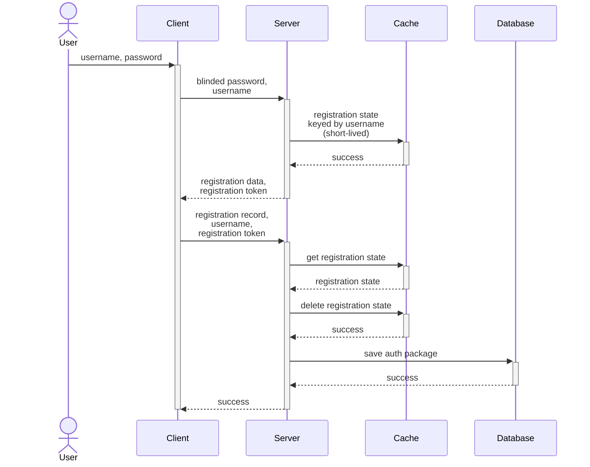

# Overview
The registration process is based on the [OPAQUE Spec](https://datatracker.ietf.org/doc/html/draft-irtf-cfrg-opaque-14) and 
implemented with [opaque-ke](https://github.com/facebook/opaque-ke). [Serenity-kit/opaque](https://github.com/serenity-kit/opaque) 
is used to allow for the Rust crate to be bundled with and used inside the backend's Node runtime package.

# OPAQUE Registration

